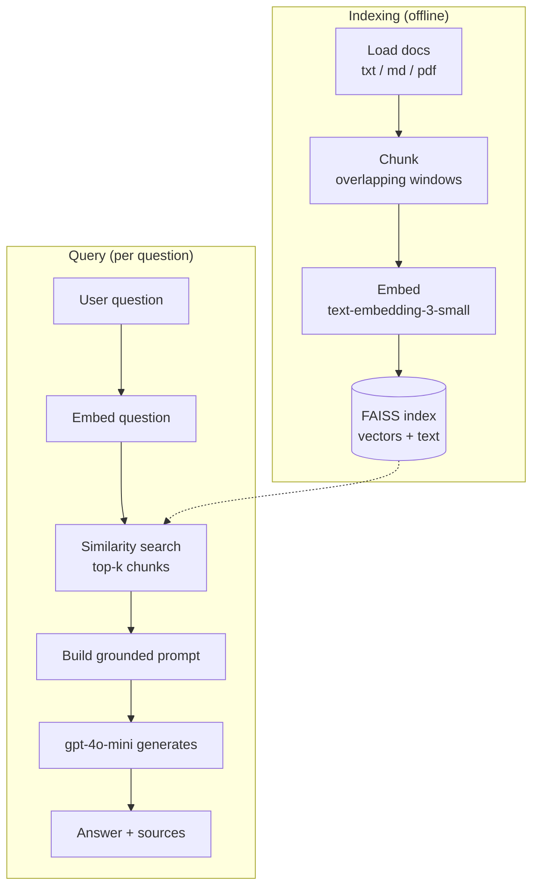

# Minimal RAG Pipeline

A small, from-scratch **Retrieval-Augmented Generation (RAG)** pipeline over local
documents, built for learning. It uses **Azure OpenAI** for embeddings and chat,
and an in-memory **FAISS** index for similarity search — no frameworks like
LangChain or LlamaIndex, so every step is visible and easy to follow.

---

## What is RAG?

Instead of asking a language model to answer purely from memory (which hallucinates
and can't know your private documents), RAG:

1. Stores your documents as searchable **vectors**.
2. At query time, **retrieves** the most relevant chunks.
3. **Injects** those chunks into the prompt as context.
4. Lets the model **generate** an answer grounded in that context — with citations.

There are two distinct phases — an offline **Indexing** phase and an online
**Query** phase:



---

## Project structure

```
Playground/
├── rag/
│   ├── loader.py      # 1. read .txt/.md/.pdf files -> (text, source)
│   ├── chunker.py     # 2. split text into overlapping word windows
│   ├── embedder.py    # 3. Azure OpenAI embeddings (batched)
│   ├── store.py       # 4. FAISS vector store (cosine via inner product)
│   └── pipeline.py    # 5+6. retrieve + grounded generation
├── data/
│   └── about_rag.md   # sample document to index
├── main.py            # CLI entry point: `index` and `ask`
├── requirements.txt   # openai, numpy, python-dotenv, faiss-cpu, pypdf
├── .env.example       # template for required configuration
└── .env               # your real config (gitignored, never committed)
```

---

## How each component works

| Stage | File | Responsibility | Key detail |
|-------|------|----------------|------------|
| **Loader** | [rag/loader.py](rag/loader.py) | Read every supported file under a folder into raw text + its source path. | PDFs are parsed with `pypdf`; bad bytes are ignored so one file can't crash the run. |
| **Chunker** | [rag/chunker.py](rag/chunker.py) | Split long text into overlapping word windows (default 200 words, 40 overlap). | Overlap keeps ideas that span a boundary intact in at least one chunk. Chunking is the #1 lever on retrieval quality. |
| **Embedder** | [rag/embedder.py](rag/embedder.py) | Turn text into 1536-dim vectors via `text-embedding-3-small`. | Sends the whole batch in one API call (cheaper + faster) and preserves order. |
| **Vector store** | [rag/store.py](rag/store.py) | Hold vectors in `faiss.IndexFlatIP` and run exact top-k search; keep parallel `texts`/`sources` lists. | Vectors are **L2-normalized** so the inner product equals **cosine similarity**. FAISS only stores vectors + integer IDs, so we map IDs back to text ourselves. |
| **Pipeline** | [rag/pipeline.py](rag/pipeline.py) | Tie it together: index a folder, then retrieve + generate a grounded answer. | A strict system prompt forbids answering from outside the retrieved context — this is what separates RAG from a plain chatbot. |
| **CLI** | [main.py](main.py) | `index` and `ask` subcommands. | `ask` indexes the data folder, then answers and prints sources. |

### Why cosine = dot product here

Cosine similarity is:

$$\cos(\mathbf{a},\mathbf{b}) = \frac{\mathbf{a}\cdot\mathbf{b}}{\lVert\mathbf{a}\rVert\,\lVert\mathbf{b}\rVert}$$

If every vector is L2-normalized so its length is 1, the denominator becomes 1 and
cosine collapses to the plain dot product. FAISS's fast `IndexFlatIP` computes inner
products — so normalizing once at insert time gives cosine ranking for free.

---

## Setup

### 1. Create / activate a virtual environment

```powershell
python -m venv .venv
.\.venv\Scripts\Activate.ps1
```

### 2. Install dependencies

> Install with the venv's interpreter to avoid hitting a global Python by mistake:

```powershell
.\.venv\Scripts\python.exe -m pip install -r requirements.txt
```

### 3. Configure Azure OpenAI

Copy the template and fill in your own values:

```powershell
Copy-Item .env.example .env
```

[.env](.env) is **gitignored** and must never be committed. Required variables:

| Variable | Description | Example |
|----------|-------------|---------|
| `AZURE_OPENAI_ENDPOINT` | **Base** resource URL only — no path or query string. | `https://<resource>.cognitiveservices.azure.com/` |
| `AZURE_OPENAI_API_KEY` | Your Azure OpenAI key. | `********` |
| `OPENAI_API_VERSION` | API version. | `2024-10-21` |
| `AZURE_OPENAI_EMBED_DEPLOYMENT` | Embedding model deployment name. | `text-embedding-3-small` |
| `AZURE_OPENAI_CHAT_DEPLOYMENT` | Chat model deployment name (must differ from the embed one). | `gpt-4o-mini` |

> **Important:** `AZURE_OPENAI_ENDPOINT` must be the bare base URL. If you paste the
> full `.../openai/deployments/<name>/embeddings?api-version=...` URL, every request
> gets pinned to that one deployment and chat calls fail with `Please submit an 'input'`.
> The SDK builds the rest of the path from the endpoint + deployment + API version.

---

## Usage

Index the documents in `data/` and report the chunk count:

```powershell
.\.venv\Scripts\python.exe main.py index
```

Ask a question (indexes `data/`, then retrieves and answers):

```powershell
.\.venv\Scripts\python.exe main.py ask "What are the two phases of RAG and what is a typical value for k?"
```

Control how many chunks are retrieved with `-k`:

```powershell
.\.venv\Scripts\python.exe main.py ask "..." -k 6
```

### Example output

```
Indexed 2 chunk(s). Thinking...

Answer:
The two phases of RAG are the indexing phase and the query phase. ...
A typical value for k is between 3 and 5. (source: data\about_rag.md)

Sources:
  - data\about_rag.md (score 0.506)
```

---

## Try these experiments

- **Add your own documents** (`.txt`, `.md`, `.pdf`) to `data/` and ask cross-document questions.
- **Tune `k`** (`-k 2` vs `-k 6`) and watch how the context size changes answers.
- **Tune chunking** (`chunk_size` / `overlap` in [rag/pipeline.py](rag/pipeline.py)) and observe retrieval scores.
- **Ask an out-of-scope question** — the grounded prompt should make it say it doesn't know instead of hallucinating.

---

## Possible next steps

- **Persist the index** (save the FAISS index + texts to disk) so `ask` doesn't re-embed every run.
- **Score threshold**: drop retrieved chunks below a minimum similarity.
- **Streaming** responses from the chat model.
- **Token-based chunking** (e.g. `tiktoken`) instead of a word-count proxy.

---

## Each module runs standalone

Every file has a `__main__` smoke test you can run on its own:

```powershell
.\.venv\Scripts\python.exe -m rag.loader     # list loaded documents (no API)
.\.venv\Scripts\python.exe -m rag.chunker    # show chunk boundaries (no API)
.\.venv\Scripts\python.exe -m rag.embedder   # embed 3 sentences, print cosine (calls API)
.\.venv\Scripts\python.exe -m rag.store      # build an index and search it (calls API)
```
